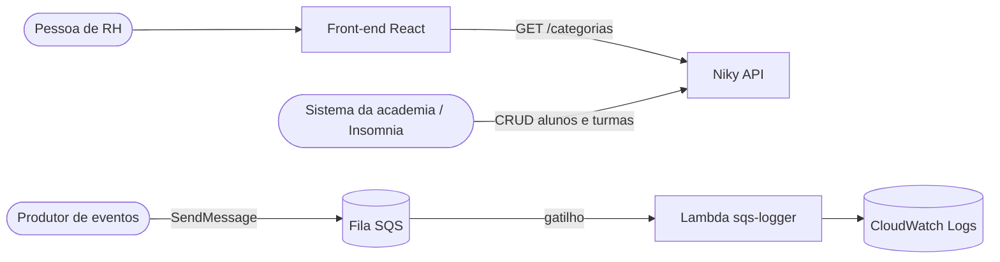
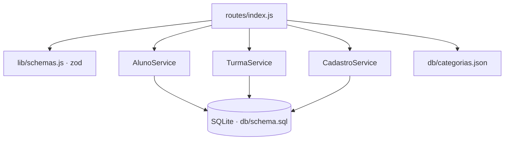

# Arquitetura alvo — Niky

## 1. Visão C4

### Nível 1 — Contexto



### Nível 2 — Contêineres

| Contêiner | Pasta | Tecnologia | Hospedagem gratuita |
|---|---|---|---|
| Front-end | `/` (raiz) | React 18, CRA 5, Bootstrap 5, react-bootstrap | GitHub Pages ou Vercel |
| API | `api/` | Node 20, Express 4, better-sqlite3, zod | Render (free) ou alwaysdata |
| Função | `lambda/sqs-logger/` | Node 20 (ESM) | AWS Lambda + SQS (nível gratuito) |

### Nível 3 — Componentes da API



## 2. Estrutura de pastas

```
niky/
├── src/                         front-end
│   ├── components/App/          tela (itens 6, 8, 9, 10) + testes
│   ├── components/ConfirmDialog.js
│   ├── services/categorias.js   cliente de GET /categorias
│   ├── utils/format.js          moeda pt-BR
│   └── Icons/
├── api/
│   ├── src/{app,server}.js
│   ├── src/db/{schema.sql,connection.js,categorias.json}
│   ├── src/services/{AlunoService,TurmaService,CadastroService}.js
│   ├── src/routes/index.js
│   └── tests/api.test.js
├── lambda/sqs-logger/           item 11
└── docs/
    ├── ANALISE.md · ARQUITETURA.md · PLANO-DE-ACAO.md
    ├── exercicios/item-02-classes.md · item-03-contratos.md · item-09-analise-critica.md
    └── sql/item-05-schema.sql · item-05-consultas.sql
```

## 3. Modelo de dados da academia (3FN)

```mermaid
erDiagram
  atividades ||--o{ turmas : tipo
  instrutores ||--o{ turmas : orienta
  instrutores ||--o{ instrutor_telefones : possui
  alunos ||--o{ matriculas : faz
  turmas ||--o{ matriculas : recebe
  matriculas ||--o{ presencas : registra
  alunos |o--o| turmas : "monitora (UNIQUE)"
  atividades { int id PK; text nome UK }
  instrutores { int id PK; text rg UK; text nome; date data_nascimento; text titulacao }
  instrutor_telefones { int id PK; int instrutor_id FK; text numero }
  alunos { int id PK; text codigo_matricula UK; date data_matricula; text nome; text endereco; text telefone; date data_nascimento; real altura_m; real peso_kg }
  turmas { int id PK; int atividade_id FK; int instrutor_id FK; int monitor_aluno_id FK_UK; int capacidade_maxima; text horario; int duracao_minutos; date data_inicial; date data_final }
  matriculas { int id PK; int aluno_id FK; int turma_id FK; date data }
  presencas { int id PK; int matricula_id FK; date data_aula; bool presente }
```

- **1FN:** telefones do instrutor em tabela própria (antes `contato[]`).
- **N:N** aluno × turma resolvido por `matriculas` (`UNIQUE (aluno_id, turma_id)`).
- **"Monitor em no máximo uma turma"** garantido pelo banco: `UNIQUE (monitor_aluno_id)`.
- **Capacidade:** verificada dentro de transação `BEGIN IMMEDIATE` (trava de escrita), evitando que duas requisições simultâneas ocupem a última vaga (condição de corrida *check-then-act*).
- **CHECK:** horário `HH:MM`, duração 10–300 min, `data_final >= data_inicial`, altura e peso em faixas plausíveis.

## 4. Contratos

Ver [exercicios/item-03-contratos.md](./exercicios/item-03-contratos.md).

## 5. Decisões de arquitetura (ADR)

### ADR-001 — Monorepo simples com `api/` e `lambda/` ao lado do front

- **Decisão:** manter o front na raiz (como estava) e criar `api/` e `lambda/` com `package.json` próprios.
- **Consequência:** cada parte instala e publica sozinha; o avaliador encontra tudo num só repositório, como o enunciado pede.

### ADR-002 — Bootstrap 5 do npm, sem jQuery

- **Decisão:** remover os três `<script>` de CDN (Bootstrap 4, jQuery 3.2.1, Popper 1) e usar `bootstrap@5` + `react-bootstrap` para o diálogo.
- **Consequência:** fim das CVEs do jQuery 3.2.1, fim do conflito de versões de CSS e nenhuma requisição externa bloqueante.

### ADR-003 — Diálogo acessível em vez de `window.confirm`

- **Decisão:** `ConfirmDialog` (Modal do react-bootstrap) com o texto exato do enunciado.
- **Consequência:** foco preso, tecla Esc e rótulos para leitor de tela; a mensagem de erro do item 10.c aparece em `role="alert"`.

### ADR-004 — SQLite na API

- **Decisão:** better-sqlite3 com schema aplicado na subida (idempotente).
- **Consequência:** "banco relacional" do item 4 sem serviço externo; em hospedagem com disco efêmero (Render free) os dados são reiniciados a cada deploy, o que é aceitável para avaliação. Para persistir, use alwaysdata ou troque por Postgres (o SQL é padrão).

### ADR-005 — `valorTotal` do mock sem recálculo

- **Decisão:** a API devolve os valores do enunciado, inclusive a divergência de "Saúde".
- **Consequência:** o mock é fiel à fonte; a divergência fica registrada em `ANALISE.md` (RN04) para decisão de produto.

## 6. Fora do escopo

- Persistir as alterações do "Resumo" na API (o item 7 pede uma API somente de leitura).
- Autenticação na API da academia.
- Publicação (depende das suas contas; roteiro no README).
