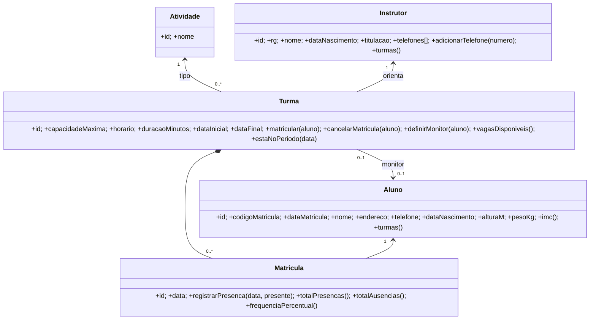

# Item 2 — Classes, métodos e justificativas (academia)

O caso de uso tem cinco conceitos com identidade própria e regras próprias. Cada um virou uma classe de domínio; as regras que envolvem mais de uma classe ficam na classe que "possui" a regra (princípio *Information Expert*, GRASP).

| Classe | Por que existe | Métodos e justificativa |
|---|---|---|
| **Atividade** | "Tipo específico de atividade" se repete entre turmas; como classe (e tabela) evita grafias diferentes ("Pilates" / "pilates"). | Só dados; nome único. |
| **Instrutor** | Tem dados próprios e "todos os telefones possíveis" (coleção). | `adicionarTelefone(numero)`: mantém a lista sem duplicatas. `turmas()`: um instrutor orienta várias turmas, de atividades diferentes. |
| **Aluno** | Entidade central do cadastro. | `imc()`: altura e peso só fazem sentido para a academia se viram indicador. `turmas()`: um aluno pode estar em várias turmas. |
| **Turma** | Agrega regras de capacidade, período e monitoria. | `matricular(aluno)`: falha se lotada ou se já matriculado. `definirMonitor(aluno)`: exige que o aluno seja da turma e que não monitore outra (a regra "no máximo uma turma" é do aluno, mas é validada ao atribuir). `vagasDisponiveis()`: capacidade − matriculados. `estaNoPeriodo(data)`: valida presenças. |
| **Matricula** | Classe associativa do N:N aluno × turma; é nela que o enunciado pede o "registro de presenças e ausências". | `registrarPresenca(data, presente)`: uma marcação por data (idempotente). `totalPresencas()`, `totalAusencias()`, `frequenciaPercentual()`: relatório de assiduidade. |

## Onde isso está no código

Na API (`api/src`), as regras foram implementadas em serviços que operam sobre o banco relacional (padrão *Transaction Script*, adequado ao tamanho do problema):

| Método de domínio | Implementação |
|---|---|
| `Turma.matricular` | `TurmaService.enroll` (transação `IMMEDIATE` para não vender a última vaga duas vezes) |
| `Turma.cancelarMatricula` | `TurmaService.unenroll` (tira o monitor se ele sair da turma) |
| `Turma.definirMonitor` | `TurmaService.update` + `assertMonitor` + `UNIQUE (monitor_aluno_id)` |
| `Matricula.registrarPresenca` | `TurmaService.registerAttendance` (`ON CONFLICT DO UPDATE`) |
| `Matricula.totalPresencas/Ausencias` | agregação `SUM/COUNT` em `TurmaService.get` |
| `Instrutor.adicionarTelefone` | `CadastroService.createInstrutor` (tabela `instrutor_telefones`) |

## Diferenças em relação ao DER entregue no item 1

O DER em `.github/draw.io` tem `contato[]` e `titulacao[]` como atributos multivalorados e a presença como atributo da aula. Para ficar em **1FN** e representar o N:N, o modelo implementado separa `instrutor_telefones` e cria `matriculas` (com `presencas` ligada à matrícula, não à turma).
