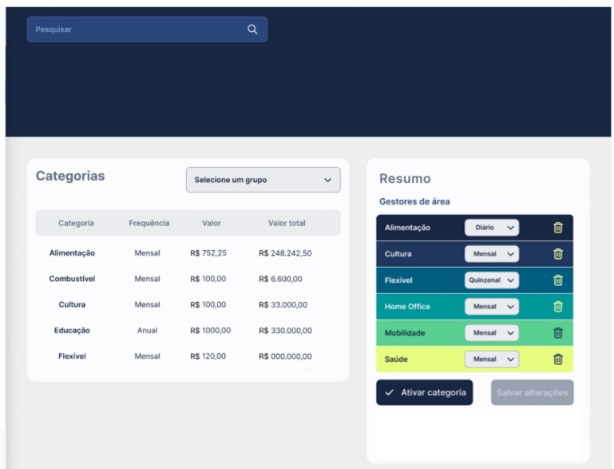
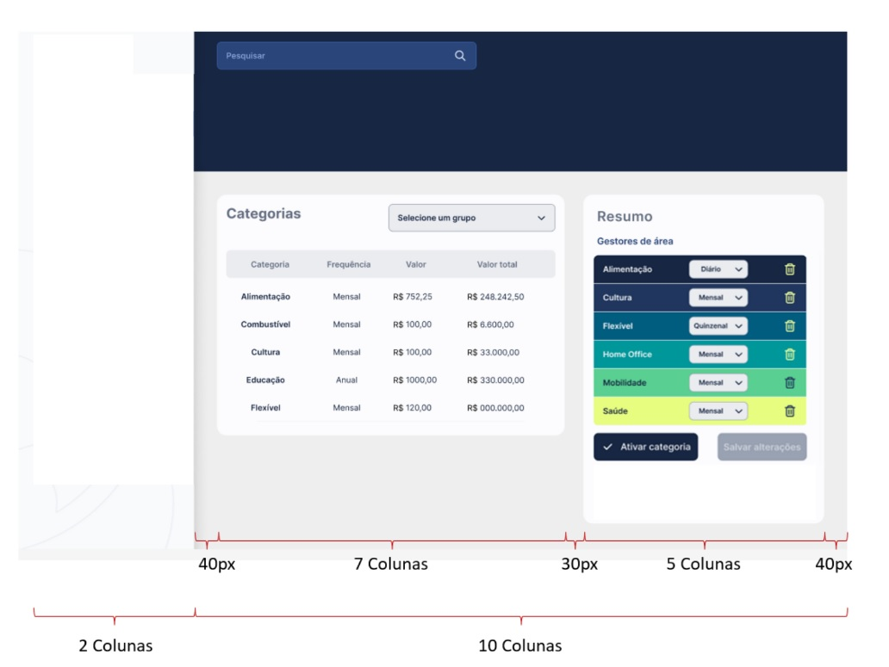
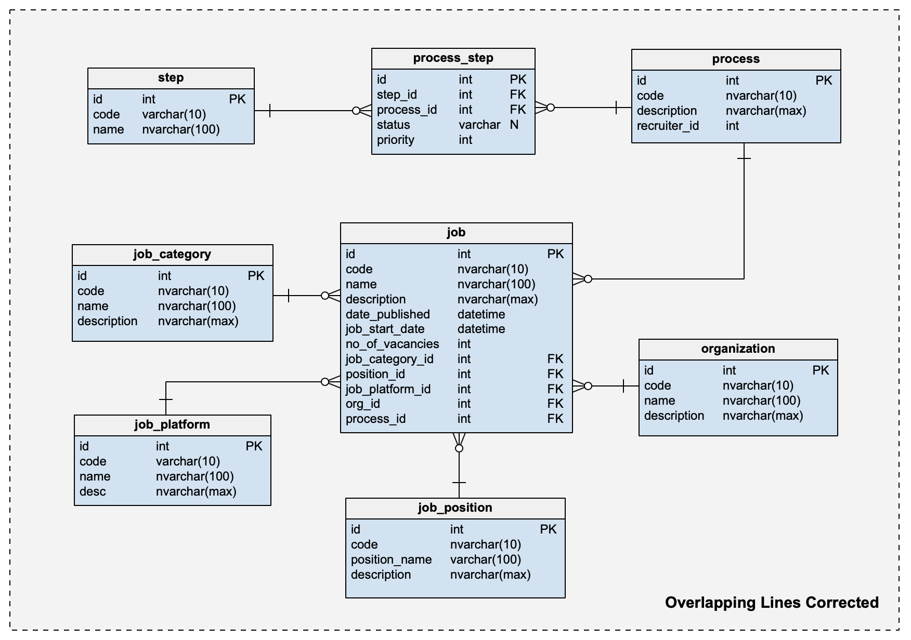
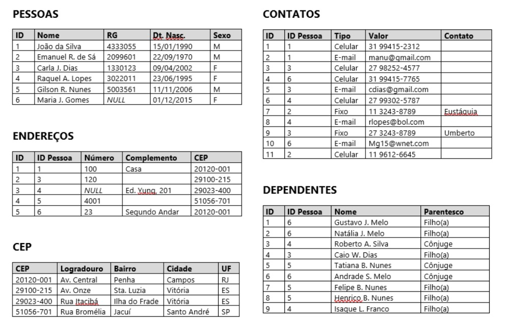
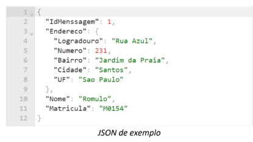
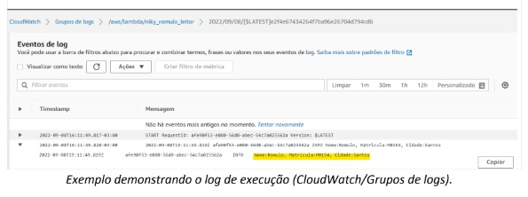
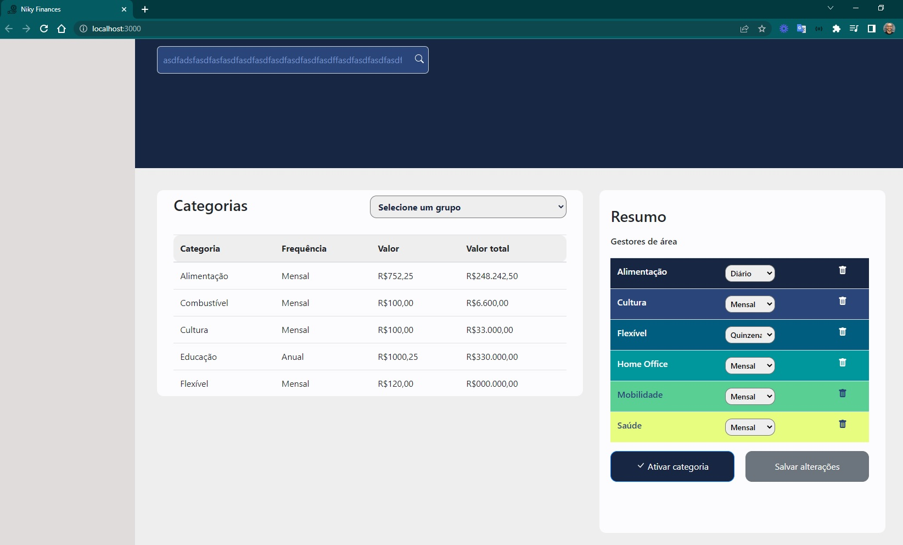
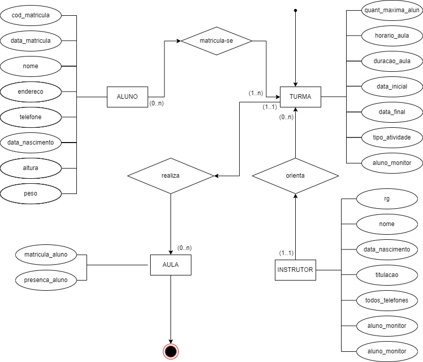
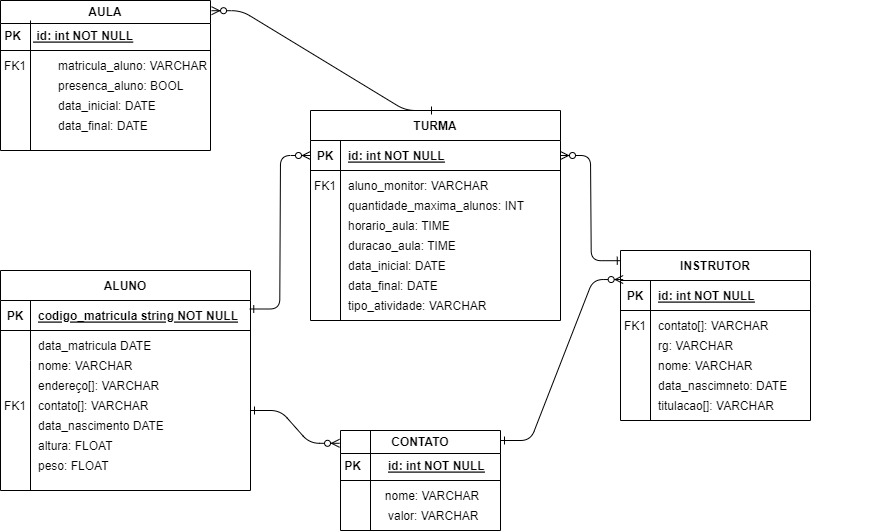

> **Projeto de estudo.** Estado conferido em 31/10/2026: os endereços que seguem fora do ar foram retirados deste README. Detalhes em [docs/AVALIACAO.md](docs/AVALIACAO.md) e próximos passos em [docs/PLANO-ESTRATEGICO.md](docs/PLANO-ESTRATEGICO.md).

<h4 align="center"> 
	Niky 🚀
</h4>

<p align="center" style="display: flex; align-items: flex-start; justify-content: center;">
  
</p>    

### 💻 Sobre o desafio

Esse projeto compreende tanto disciplinas de front-end quanto de back-end.
O teste deve ser realizado com React e Node, mas o objetivo é analisar o seu entendimento dos conceitos e das boas práticas de desenvolvimento.

### ▶️ Como executar

Pré-requisito: Node.js 20 ou superior. São duas partes: a API (`api/`) e o front-end (raiz).

```bash
# 1) API: mock de categorias (item 7) e CRUD da academia (itens 3 e 4)
cd api
npm install
npm start                 # http://localhost:3333  ·  npm test (8 testes)

# 2) Front-end (itens 6, 8, 9 e 10), em outro terminal
cd ..
npm install
npm start                 # http://localhost:3000  ·  npm test -- --watchAll=false (6 testes)
```

O front busca `GET {REACT_APP_API_URL}/categorias`; sem a variável, usa `http://localhost:3333`.

### ☁️ Publicação gratuita

**Demonstração:** https://niky.onrender.com (front). A API publicada não responde, então os dados só aparecem rodando localmente (seção "Como executar").

- Os dois serviços sobem juntos pelo `render.yaml` (Blueprint do Render): a **API** como serviço web gratuito com *root directory* `api`, e o **front** como site estático com `REACT_APP_API_URL` apontando para a API.
- A API dorme após 15 min sem acesso (a primeira chamada leva ~1 min) e o SQLite é recriado a cada reinício.
- **Item 11:** siga [lambda/sqs-logger/README.md](./lambda/sqs-logger/README.md).
- Passo a passo completo: [docs/DEPLOY.md](docs/DEPLOY.md).

### 📊 Estado do MVP & Documentação

| Documento | Conteúdo |
|---|---|
| [docs/ANALISE.md](./docs/ANALISE.md) | Situação de cada item, diagnóstico, rubrica e notas antes/depois |
| [docs/ARQUITETURA.md](./docs/ARQUITETURA.md) | C4, modelo 3FN da academia e ADRs |
| [docs/PLANO-DE-ACAO.md](./docs/PLANO-DE-ACAO.md) | Tarefas priorizadas por MoSCoW |
| [docs/exercicios/item-02-classes.md](./docs/exercicios/item-02-classes.md) | Item 2 — classes, métodos e justificativas |
| [docs/exercicios/item-03-contratos.md](./docs/exercicios/item-03-contratos.md) | Item 3 — contratos REST |
| [docs/exercicios/item-09-analise-critica.md](./docs/exercicios/item-09-analise-critica.md) | Item 9 — o que foi aplicado da análise |
| [docs/sql/item-05-consultas.sql](./docs/sql/item-05-consultas.sql) | Item 5 — queries (com [schema e dados](./docs/sql/item-05-schema.sql)) |

| Momento | Nota MVP | Situação |
|---|---|---|
| Antes (27/09/2026) | 3,62 | Reprovado — 7 de 11 itens sem entrega |
| Depois (27/09/2026) | 8,48 | Aprovado — faltam só a publicação e os prints da AWS |

### ✅ Requisitos

- [x] Um repositório no GitHub onde subirá todo código das funcionalidades desenvolvidas e os
arquivos SQL gerados.
- [ ] Uma conta em uma plataforma de aplicação gratuita de sua preferência, onde você publicará as APIs que criar. *(API pronta em `api/`; falta publicar)*
- [ ] Uma conta gratuita para construir uma fila SQS. *(código e roteiro em `lambda/sqs-logger/`)*

### 🎨 Tarefas Frontend

6. Criar o layout a seguir



  - [x] a. considerando o padrão Bootstrap de divisão em 12 colunas, respeitando os espaçamentos descritos na imagem
  - [x] b. demais espaçamentos, alturas e larguras dos objetos podem ser aplicados conforme o seu bom senso 
  - [x] c. OBJETIVO: Analisar a sua capacidade de converter layouts entregues pela equipe de produtos em telas de sistema
  - [x] d. Utilizar react para construir o design.

9. Faça uma análise crítica do protótipo do item 6 do frontend 

- [x] a. indique pontos de melhoria do layout apresentado. 
  - [x] 1. ajustar a aplicação para ocupar a tela inteira aonde estiver sendo exibida
  - [x] 2. na navbar, a barra de pesquisa ficaria mais interessante alinhado a direita
  - [x] 3. nas tabelas, seria mais confortável com o mesmo design, sugiro algo como a categoria
  - [x] 4. na tabela de categoria, inserir as linhas horizontais para os registros
  - [ ] 5. na tabela de categoria, completaria o crud da tabela. Inserir uma coluna com as ações de deleção e update, adicionaria um botão para adicionar registro.
  - [x] 6. na tabela de resumo, remover as cores das linhas, remover o negrito do texto dos registros
  - [x] 7. na tabela de resumo, os botões devem seguir o mesmo design, ambos com icon ou ambos sem icon.
  - [x] 8. na tabela de resumo, as funcionalidades dos botões deveriam ser revisadas já que são duas afirmativas
  - [x] 9. a principal cor é a da navbar. partindo que é uma boa cor, os botões devem ter cores marcantes primary e secondary. Seguindo o material design lite, apliquei esse azul como primary e então gerei a segunda cor de contraste.
  - [x] 10. aplicando o comportamento de responsividade, caso a tela for maior que max-width, então centralizar ambas tabelas. A navbar seguiria com width 100% mas a barra de busca seguiria alinhada com as tabelas.
  - [x] 11. aplicando o comportamento de responsividade, caso a tela ficasse menor que o min-width, então, a tabela resumo iria para debaixo da tabela categoria com uma margin e ambas ficariam com width 100% dessa tela (tablet, smartphone)
  - [ ] 12. uma alternativa interessante é colocar uma funcionalidade em cada rota, ou seja, criar uma aba para categorias e uma outra aba para resumo. Na aba categoria, um crud de categoria. Na aba resumo, um crud também.
- [x] b. Exemplo: Cores, espalhamentos, tamanho de fonte, alinhamento de objetos e texto, larguras, etc.
- [x] c. OBJETIVO: Analisar seu senso crítico e capacidade de colaborar com o fluxo produtivo como um todo.

10.   Usando o layout criado, no “gestor de categorias”, implemente javascripts que permitam:

- [x] a. Ao clicar em um dos ícones “lixeira” presentes nas linhas de categoria, a mensagem de confirmação: “Deseja excluir essa categoria?” seja exibida. 
- [x] b. Se o usuário confirmar a exclusão, a linha onde o botão está posicionado seja removida;
- [x] c. Uma mensagem de erro seja disparada se a frequência informada no combo da linha que está sendo excluída for igual a “mensal”;
- [x] d. OBJETIVO: Testar sua capacidade em implementar ações no lado do cliente.

### 🚀 Tarefas Backend

**Definições**: A modelagem de dados consiste em criar um diagrama simplificado de um sistema de software e dos seus elementos de dados. Isso é feito usando texto e símbolos para representar os dados e como eles fluem. Os modelos de dados são fluxograma que ilustram as entidades de dados, seus atributos e os relacionamentos entre as entidades. 

1. Proponha um modelo de dados e o represente em um DER (diagrama de entidade relacionamento) que contemple a situação descrita abaixo:

**ACADEMIA DE GINÁSTICA**

Uma academia de ginástica deseja manter um controle do seu funcionamento. Os alunos são organizados em turmas associadas a um tipo específico de atividade. As informações sobre uma turma são quantidade máxima de alunos, horário da aula, duração da aula, data inicial, data final e tipo de atividade.

Cada turma é orientada por um único instrutor para o qual são cadastrados RG, nome, data de nascimento, titulação e todos os telefones possíveis para sua localização. Um instrutor pode orientar várias turmas que podem ser de diferentes atividades. Para cada turma
existe um aluno monitor que auxilia o instrutor da turma, sendo que um aluno pode ser monitor no máximo em uma turma.

Os dados cadastrados dos alunos são: código de matrícula, data de matrícula, nome, endereço, telefone, data de nascimento, altura e peso.

Um aluno pode estar matriculado em várias turmas se deseja realizar atividades diferentes e para cada matrícula é mantido um registro das
presenças e ausências do aluno.

**Garantias**

- [x] a. todas as ENTIDADES possuam nome
- [x] b. todos os ATRIBUTOS listados estejam representados
- [x] c. que sejam definidos os tipos de dados para cada atributo (utilize INT para números inteiros, VARCHAR para strings, BOOL para booleanos, FLOAT para números decimais, DATE para datas, e TIME para horas)
- [x] d. que seja possível identificar os RELACIONAMENTOS entre as entidades
- [x] e. seja possível identificar as CHAVES em cada entidade
- [x] f. utilize a ferramenta de sua escolha para a construção do DER (Miro, Draw.io, Lucid, ou qualquer outro que desejar)
- [x] g. Entregue como resultado uma imagem (com boa definição) de seu diagrama.
- [x] h. OBJETIVO: Compreender o seu quanto de conhecimento em relação à MODELAGEM DE DADOS RELACIONAIS e sua capacidade de interpretar um CASO DE USO e traduzi-lo em um MODELO DE DADOS aplicável.  

### Inspirações MER

<p align="center" style="display: flex; align-items: flex-start; justify-content: center;">
  
</p>  

### Inspirações DER

<p align="center" style="display: flex; align-items: flex-start; justify-content: center;">
  
</p>

### Compreensão

- O cenário é para controlar o funcionamento de uma academia de ginástica
- e ter os alunos organizados em turmas associadas a um tipo específico de atividade
- informações de uma turma: quantidade máxima de alunos, horário de aula, duração de aula, data inicial, data final, tipo de atividade e instrutor (único)
- informações do instrutor: rg, nome, data de nascimento, titulação, todos os telefones
- um instrutor pode orientar várias turmas que podem ser de diferentes atividades
- para cada turma tem um aluno monitor da turma
- um aluno monitor só pode ser monitor de uma turma
- os dados cadastrados dos alunos: código de matrícula, data de matrícula, nome, endereço, telefone, data de nascimento, altura, peso
- um aluno pode estar matriculado em várias turmas se desejar realizar atividades diferentes
- e para cada matrícula é mantido o registro das presenças e ausenças do aluno

2. Considerando o caso de uso do item 1 do backend: 

**Garantias**

- [x] a. demonstrar as classes
- [x] b. propor os métodos necessários para as classes identificadas
- [x] c. justificar o motivo de sua criação 
- [x] d. OBJETIVO: Compreender o quanto de conhecimento você possui em relação à programação orientada a objetos e sua capacidade de aplicá-la em um caso de uso apresentado.

3. Ainda baseado no caso de uso do item 1 do backend: 

**Garantias**

- [x] a. monte os contratos dos métodos necessários para implementar o cadastro dos alunos e turmas (CRUD), contemplando as particularidades apresentadas no texto.
- [x] b. OBJETIVO: Compreender a sua capacidade prática em transformar um caso de uso em APIs REST.

4. Baseado nos contratos criados no item 3 do backend:  

**Garantias**

- [x] a. implemente as APIs persistindo os dados em um banco de dados relacional
- [x] b. suba o código no GitHub 
- [x] c. OBJETIVO: Compreender a sua capacidade prática em desenvolvimento back-end.

5. As tabelas abaixo estão representadas uma estrutura de dados de um cadastro de pessoa:



Com base nas tabelas acima, escreva queries que atendam às necessidades descritas nos tópicos a seguir.

**Garantias**

- [x] a. Para etiquetar uma remessa de correspondência, crie uma query que apresente o nome da
pessoa e seu endereço. Importante: Apenas pessoas com endereço devem ser exibidas na
lista 
- [x] b. Para que possamos alertar a equipe responsável, crie uma query que identifique eventuais
pessoas que não possuam endereço 
- [x] c. Levando em conta que todos os campos do cadastro dos dados pessoa são obrigatórios, crie
uma query que apresente as pessoas que possuem erro em seu cadastro, para que a equipe
possa complementá-lo
- [x] d. Monte uma lista telefônica com “Nome”, “Sexo”, “Telefone” e “Contato”, onde telefone deve
exibir celular ou fixo. Importante: Todas as pessoas devem ser exibidas na lista, mesmo quem
não tenha telefone
- [x] e. Crie uma query que apresente as pessoas com mais de 1 filho 
- [x] f. OBJETIVO: Compreender seu nível de conhecimento sobre a construção de queries SQL a partir
da compreensão de um modelo de dados simples. 

7. Conforme as informações da tabela abaixo:


- [x] a. Criar uma API mock [GET]/categorias que entregue em um JSON as informações
- [ ] b. publicar no Heroku ou em outra hospedagem gratuita que julgar mais simples para você *(pendente: Render ou alwaysdata)*
- [x] c. OBJETIVO: Entender se você conhece o conceito de mock e tem habilidade de realizar uma
publicação em ambiente real.

8. Utilizando a API [GET]/categorias do item 7 do backend

- [x] a. apresentar a tela que você criou no item 6 do frontend consumindo os dados e montando dinamicamente as 2 tabelas existentes na tela.
- [x] b. Obs: Caso você não tenha respondido a questão anterior, você pode utilizar o seguinte serviço:
https://ufmsd4brfl.execute-api.us-east-1.amazonaws.com/avaliacao-niky/categorias
- [x] c. OBJETIVO: Analisar a sua capacidade de converter layouts entregues pela equipe de produtos em
telas de sistema.

11. Usando a AWS gratuitamente 

- [ ] a. criar uma fila SQS atachada com uma trigger Lambda que leia a
mensagem entregue e grave no log de execução o conteúdo do JSON 



Para evidenciar seu desenvolvimento print:

- [ ] b. A tela que demonstra a vinculação da fila com o lambda;
- [x] c. O código do serviço lambda; *(`lambda/sqs-logger/index.mjs`)*
- [ ] d. A tela do log de execução com o conteúdo, conforme exemplo abaixo.



- [ ] e. OBJETIVO: Compreender se você possui os conhecimentos básicos para operar uma fila de
processamento assíncrono.

### 💡 Referências

- [reactjs](https://reactjs.org/)
- [bootstrap](https://icons.getbootstrap.com/)
- [react-bootstrap](https://react-bootstrap.github.io/components/table/)
- [material design](https://getmdl.io/customize/index.html)
- [CRUD Operations](https://www.youtube.com/watch?v=QVokz2OrEy8)
- [modelos-de-dados](https://www.infonova.com.br/gestao-de-ti/o-que-sao-modelos-de-dados/)
- [modelagem-bd](https://www.devmedia.com.br/mer-e-der-modelagem-de-bancos-de-dados/14332)
- [mer-e-der](https://www.alura.com.br/artigos/mer-e-der-funcoes)

### 📅 Entregas Frontend

- [x] instalar as dependências react, bootstrap
- [x] inserir favicon
- [x] inserir icons
- [x] dimensionar os elementos 
- [x] posicionar os elementos 
- [x] estilizar os elementos os elementos 
- [x] remover linhas da tabela category e ajustar design
- [x] estruturar o crud em objeto
- [x] revisado a lógica do item  10.c
- [x] posicionar icons
- [x] border-radius da tabela resume e ajustar design
- [x] refatorar e componentizar (ConfirmDialog, cliente da API, formatação)
- [x] consumir `GET /categorias` com estados de carregando e erro (item 8)
- [x] Bootstrap 5 via npm, sem jQuery/CDN
- [x] acessibilidade verificada com axe-core

### 📅 Tela Entregues

<p align="center" style="display: flex; align-items: flex-start; justify-content: center;">
  
</p>  

### 📅 Entregas Backend

- [x] Entender o modelagem de dados do item 1
- [x] Rascunhar o MER do item 1
- [x] Rascunhar o DER do item 1
- [x] Item 2: classes e métodos ([docs](./docs/exercicios/item-02-classes.md))
- [x] Item 3: contratos REST ([docs](./docs/exercicios/item-03-contratos.md))
- [x] Item 4: API da academia em `api/` com SQLite, 3FN e testes
- [x] Item 5: queries verificadas ([SQL](./docs/sql/item-05-consultas.sql))
- [x] Item 7: `GET /categorias` em `api/`
- [x] Item 11: código da Lambda e roteiro

### 📅 Dados Entregues

- MER no drawio
<p align="center" style="display: flex; align-items: flex-start; justify-content: center;">
  
</p>  

- DER no drawio
<p align="center" style="display: flex; align-items: flex-start; justify-content: center;">
  
</p>  

### 🚀 Conclusão

Esse projeto avalia a habilidade de realizar tarefas de frontend e backend juntamente com soft skills, como, a compreensão e interpretação das tarefas em texto, buscar respostas e perguntar a outros membros da equipe conforme os processos de desenvolvimento em equipe.

Feito com ❤️ por Douglas A B Novato. 👋🏽 [Entre em contato!](https://www.linkedin.com/in/douglasabnovato/)
 
Fonte do projeto na [niky](https://www.niky.com.vc/) 👋  